  

### ✦ About me

Hi, I'm **Nazanin Parmah**, a product designer. Since 2022 I've designed landing pages, mobile apps, dashboards and even a Telegram bot for agencies, studios and local businesses. I studied English Literature.

These days I'm an **AI-augmented designer**. With Claude, Gemini AI Studio and Figma Make, I designed an Instagram automation tool in 3 days and a management panel for an eyewear shop in one week. Now I'm stepping into code, and this GitHub is where I practice. The pixel sakura up top is drawn by a small Python script.

- **Now:** product designer at DoukhteBartar
- **I do:** mobile and web design, user research, user flows, information architecture, wireframes, prototypes, design systems
- **I use:** Figma (advanced), Figma Make, Claude, GPT, Gemini AI Studio, Nano Banana, Notion, Trello
- **Off-screen:** Murakami, Miyazaki, podcasts, painting, music, nature, cats, cows, candles, and anything blue

### ✦ Selected work

- **Landing pages:** Eskano · SELFiT · a voice agent (VUI) · Barchian's photography portfolio · iBolak redesign
- **Apps:** a podcast-first music app · a visitor app for sales teams · a QR menu for a café
- **Dashboards:** SELFiT B2B/B2C panel · a POS with live inventory · a product returns flow
- **AI-assisted sprints:** Ripli, Instagram automation (3 days) · an optical shop panel in Figma Make (1 week) · a Telegram ads bot (3 days)

### ✦ Let's create together

I love bold ideas and projects that leave a mark. Say hi at [nazaniinparmaah@gmail.com](mailto:nazaniinparmaah@gmail.com).

  

